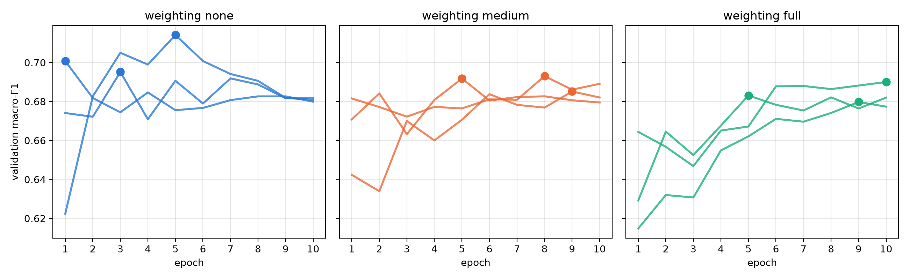
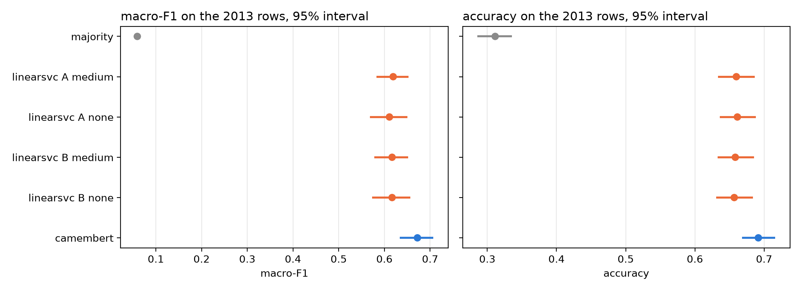

# Geneva building-permit classification

This project has two parts. It is a classification of French building-permit descriptions from Geneva's open register (SITG), from the description text alone. The pilot phase compares a majority baseline, TF-IDF + LinearSVC and CamemBERTav2, with every modelling choice fixed on the validation years and in `config.yaml` before the 2013 test is scored. The research extension then asks whether the order in which the encoder is trained matters.

## Reproduce

```sh
uv sync                               
uv run permits data fetch             
uv run permits data preprocess       
uv run permits train majority         
uv run permits train linearsvc A     
uv run permits train linearsvc B     
uv run permits train curves           
uv run permits train camembert pilot 
uv run permits train camembert main   
uv run permits train camembert curves 
uv run permits evaluate test          
uv run permits predict "<description>"   
uv run mlflow ui --backend-store-uri sqlite:///mlruns/mlflow.db  
```

Every setting is in `config.yaml`. Runs are stored in the MLflow store under `mlruns/`; the test
runs are tagged with their git commit and the snapshot's SHA-256. Every CamemBERT run logs a
fingerprint of its training settings, the model revision and the training and validation rows it
was given. The CamemBERT steps resume where they stopped and reuse a finished run only when its
fingerprint matches. Selection, the test, `permits predict` and the notebooks read only finished
runs with the current fingerprint and learning rate; two runs of one weighting and seed raise an
error instead of being averaged. `data/processed/texts.parquet` records the snapshot, the split and
the split settings it was made from and is refused once any of them changes.
`permits data verify` re-checks the archive, and `permits data splits` rewrites
`data/splits/splits.csv`, which is only needed after a deliberate change to the split rules.

**Hardware.** CamemBERTav2 fine-tuning ran on one NVIDIA GeForce RTX 2070 (8 GB) in fp16, about
18 minutes per run and four hours for the pilot, the nine main runs and the curves together. The LinearSVC grids take
half an hour on a CPU.

## Settings and sources

| Setting | Value | Source |
|---|---|---|
| LinearSVC C grid | 2^-5, 2^-3, …, 2^15 | Hsu, Chang & Lin (2003), *A Practical Guide to Support Vector Classification*, §3.2 |
| Epochs | 10, keeping the best validation epoch | He, Gao & Chen (2023), DeBERTaV3, Table 11 |
| AdamW | betas (0.9, 0.999), epsilon 1e-6, weight decay 0.01, gradient clipping 1.0 | DeBERTaV3, Table 11 |
| Batch size | 32 | Antoun et al. (2024), CamemBERT 2.0, Table 7 |
| Warmup | 10% of the steps, then linear decay | CamemBERT 2.0, Table 7 |
| Pilot learning rates | 3e-5, 5e-5, 7e-5; 3e-5 kept | CamemBERT 2.0, Table 7 |
| Bootstrap | 2,000 dossier-clustered resamples, 95% percentile intervals | Efron & Tibshirani (1993), *An Introduction to the Bootstrap* |
| Paired bootstrap | model differences on the same resamples | Berg-Kirkpatrick, Burkett & Klein (2012) |
| Class weights | none; medium: sqrt(n / (K n_c)) rescaled to mean 1; full: n / (K n_c) | King & Zeng (2001); Mahajan et al. (2018) |

## Data


There are many labels from 1999 to 2013 but they are rare afterwards, so the partitions follow the filing year: training through 2010 (30,782 rows), validation 2011–2012 (2,794), test 2013 (1,320).
Records from 2014 onwards are reserved for the research extension. No dossier spans two partitions and no normalized text reaches an evaluation partition from training. `01_data_exploration.ipynb` holds the full audit; `02_preprocessing.ipynb` runs and checks the lemmatization.

## Results


On the validation years (2011–2012) CamemBERTav2 leads TF-IDF + LinearSVC by 3 to 4 points of
macro-F1 at every training size, 0.703 against 0.661 on the full training set. Per-row class
weighting did not help either model. `03_validation_results.ipynb` has every validation table and
figure.



Each CamemBERTav2 run trains all ten epochs and keeps the epoch with the best validation macro-F1
(the dots, one line per seed). Without weighting the runs peak early, at epochs 1, 3 and 5; with
class weighting they peak later, at epochs 5 to 10, and lower. By epoch 10 all nine runs end
between 0.677 and 0.690, so the lead of the unweighted runs comes from the epoch the selection
keeps, which also makes their validation scores optimistic.



On the 2013 test, scored once with every setting fixed beforehand, CamemBERTav2 reaches macro-F1
0.672 (mean of three seeds) against 0.617 for the selected LinearSVC. The paired difference over
2,000 dossier-clustered resamples is 5.5 points, 95% interval 2.6 to 8.3, in accuracy 3.3 points,
1.8 to 5.0. Neither lemmatization nor weighting makes a measurable difference to LinearSVC on the
test. AFF, the rarest class with 12 test rows, stays the weakest for both models, and the large
confusions, PI with REN and PI with EQU, are shared. `04_test_results.ipynb` holds the per-class
intervals, the confusion matrices and the error analysis.


## Checks

As run in CI and by the pre-push hook (`git config core.hooksPath .githooks`):

```sh
uv run ruff format --check .
uv run ruff check .
uv run pytest -q
```

## Data source

Source : Portail des données SITG (État de Genève), téléchargé en date du 27.09.2026.
Use of the data is subject to SITG's conditions of use, which ship inside the archive under
`DOC/`.
