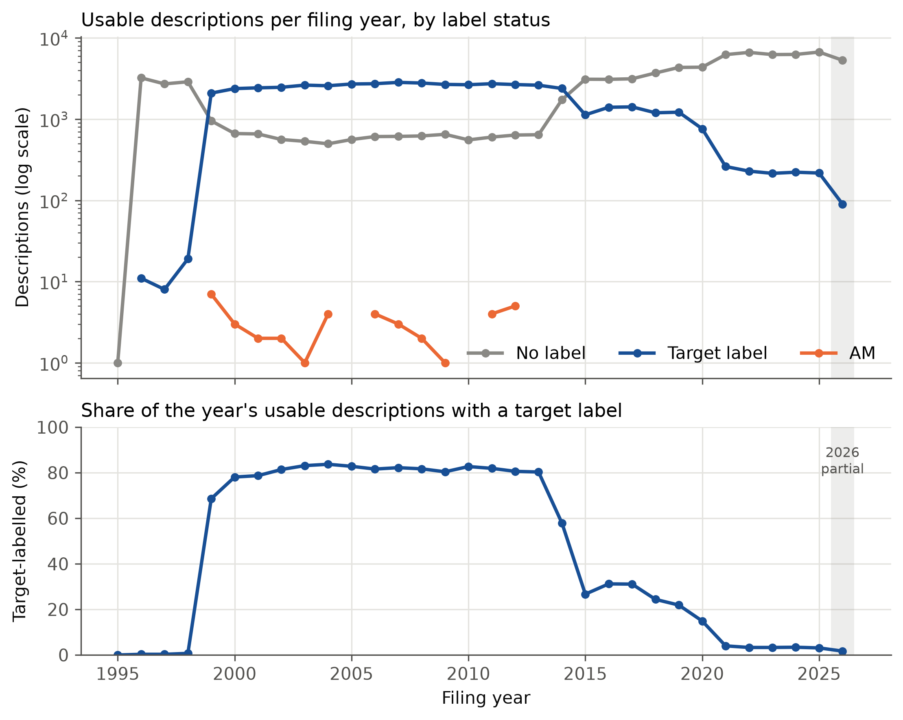
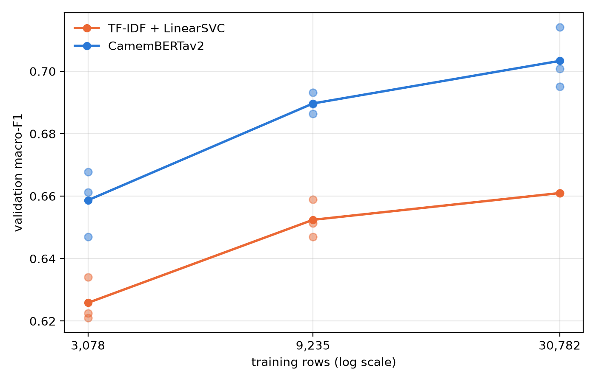
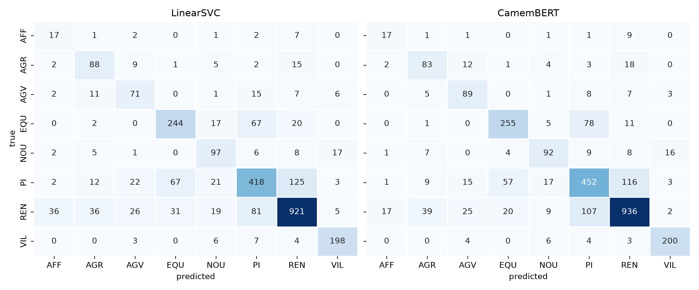

# Geneva building-permit classification

Eight-way classification of French building-permit descriptions from Geneva's open register
(SITG), from the description text alone. The pilot phase compares a majority baseline, TF-IDF +
LinearSVC and CamemBERTav2, with every modelling choice fixed on the validation years and in
`config.yaml` before the 2013 test is scored once. The research extension for SwissText then asks
whether the order in which the transformer sees LLM-generated and original labels changes what
it learns.

## Reproduce

```sh
uv sync                               # Python 3.14 environment with the geneva_permits package
uv run permits data fetch             # pinned SITG snapshot from the release mirror, SHA-256 checked
uv run permits data preprocess        # lemmatize the labelled texts into data/processed/
uv run permits train majority         # baseline, scored on the validation rows
uv run permits train linearsvc A      # TF-IDF + LinearSVC grid on the text
uv run permits train linearsvc B      # the same grid on the lemmas
uv run permits train curves           # LinearSVC learning curves on the 10% and 30% draws
uv run permits train camembert pilot  # learning-rate pilot; freeze training.learning_rate in config.yaml
uv run permits train camembert main   # weighting options x seeds, models stored
uv run permits train camembert curves # CamemBERTav2 learning curves on the same draws
uv run permits evaluate test          # the 2013 test, once, from a committed tree
uv run mlflow ui --backend-store-uri sqlite:///mlruns/mlflow.db   # browse the runs
```

Every setting and the reason for it is in `config.yaml`. Runs land in the MLflow store under
`mlruns/`, each tagged with its git commit and the snapshot's SHA-256. The CamemBERT steps resume
where they stopped. `permits data verify` re-checks the archive, and `permits data splits`
rewrites `data/splits/splits.csv`, which is only needed after a deliberate change to the split
rules.

**Hardware.** CamemBERTav2 fine-tuning ran on one NVIDIA GeForce RTX 2070 (8 GB) in fp16, about
18 minutes per run and four hours for the pilot, the nine main runs and the curves together. On
a CPU it trains in fp32: fine for the tests, too slow for the full data. The LinearSVC grids take
half an hour on a CPU.

## Data



Labels are plentiful from 1999 to 2013 and rare afterwards, so the partitions follow the filing
year: training through 2010 (30,782 rows), validation 2011–2012 (2,794), test 2013 (1,320).
Records from 2014 onwards are reserved for the extension. No dossier spans two partitions and no
normalized text reaches an evaluation partition from training. `01_data_exploration.ipynb` holds
the full audit; `02_preprocessing.ipynb` runs and checks the lemmatization.

## Validation results



CamemBERTav2 leads TF-IDF + LinearSVC by 3 to 4 points of macro-F1 at every training size:
0.703 against 0.661 on the full set, with the majority baseline at 0.073. Per-row class weighting
did not help either model.



AFF, the rarest class, is the weakest for both models, and the large confusions, PI with REN and
PI with EQU, are shared. `03_validation_results.ipynb` has every table and figure; the 2013 test
with its bootstrap intervals will be in `04_test_results.ipynb`.

## Checks

As run in CI and by the pre-push hook (`git config core.hooksPath .githooks`):

```sh
uv run ruff format --check .
uv run ruff check .
uv run pytest -q
```

## Documents

- `documentation/PILOT_PROJECT_SCOPE_v2.md`: the pilot phase.
- `documentation/SWISSTEXT_RESEARCH_SCOPE_v2.md`: the research extension.
- SwissText: the [2027 call](https://www.swisstext.org/current/) and the archived
  [2026 call for papers](https://www.swisstext.org/archive/2026/submissions/call-for-papers/).


## Data source

Source : Portail des données SITG (État de Genève), téléchargé en date du 27.09.2026.
Use of the data is subject to SITG's conditions of use, which ship inside the archive under
`DOC/`.
